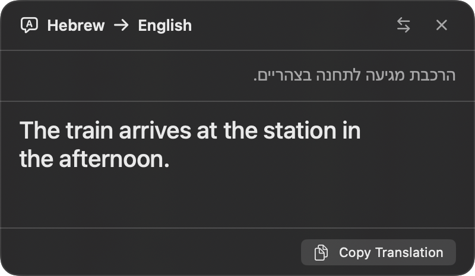

<p align="center"></p>

<h1 align="center">Saman</h1>

<p align="center">Translate text from any Mac app where you can select or copy it.</p>

<p align="center">
  <a href="https://israelor6.github.io/saman/">Website</a> ·
  <a href="https://github.com/israelor6/saman/releases/latest">Download for Mac</a> ·
  <a href="README.he.md" lang="he">עברית</a>
</p>

<p align="center"></p>

## How it works

Choose two languages in setup. Select a word or sentence in a browser, document, or chat and click the purple bubble next to it, or press <kbd>⌥</kbd><kbd>⇧</kbd><kbd>T</kbd>. Saman detects the direction between your chosen languages. You can flip the direction, drag the translation out of the way, or copy it.

The interface is available in English and Hebrew. Change it, your translation pair, and Open at Login under **Saman → Settings**.

## Install

Saman requires an **Apple silicon Mac running macOS 27 or later**.

1. Download **Saman-macOS.zip** from [Releases](https://github.com/israelor6/saman/releases/latest), unzip it, and open **Saman.app**. It can offer to copy itself to Applications.
2. The current release is ad hoc signed and hasn't been notarized. macOS may block the first launch. If you trust this release, follow [Apple’s instructions for opening an unnotarized app](https://support.apple.com/en-us/102445).
3. Choose two languages and grant the Accessibility access Saman requests. macOS may ask to download the language models the first time you translate.

When an app doesn't expose a selection through macOS Accessibility, copy the text and choose **Translate Copied Text** from Saman's menu. This also works without Accessibility access.

## Privacy

Saman uses Apple’s Translation framework to translate on the Mac. Saman has no account, app telemetry, or translation server. It uses Accessibility to find the selected text and position the bubble. It reads the clipboard when you choose **Translate Copied Text** and writes to it when you choose **Copy Translation**.

## Build and test

Use an Apple silicon Mac with the macOS 27 SDK installed through Xcode 27 or the Xcode Command Line Tools.

```sh
./scripts/build.sh --open
./build/Saman.app/Contents/MacOS/Saman --check --skip-models
./build/Saman.app/Contents/MacOS/Saman --check
```

The second command runs the CI checks, including localization, selection geometry, language detection and installation behavior. The full check also exercises Apple Translation and requires installed English and Hebrew models.

## Contribute

See [CONTRIBUTING.md](CONTRIBUTING.md) for local development, bug reports, website edits, and release steps. For security issues use [private vulnerability reporting](SECURITY.md). See [CHANGELOG.md](CHANGELOG.md) for release history. Saman is released under the [MIT License](LICENSE).
